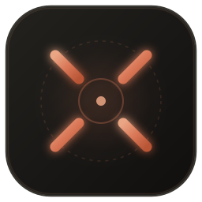
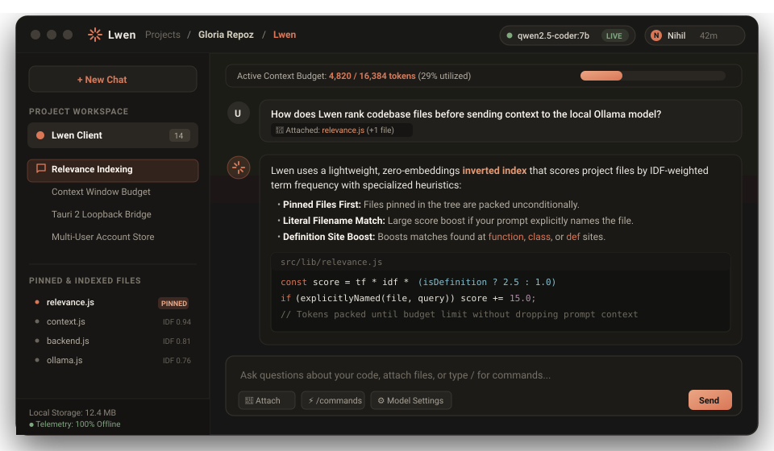
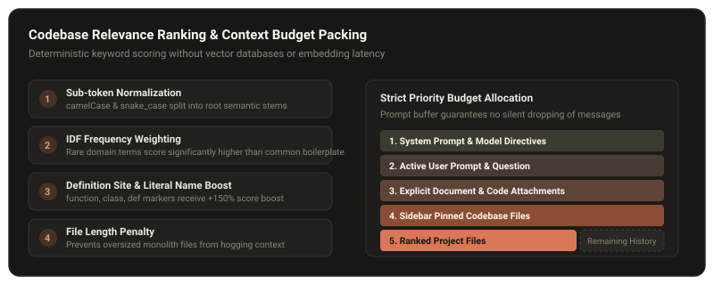
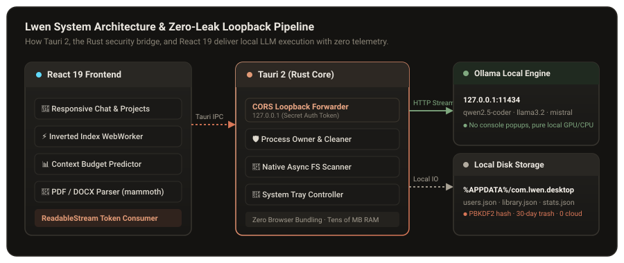

<div align="center">



# Lwen

**A refined, local-first Ollama desktop client crafted for speed, intelligence & privacy**

*Chat with local LLMs, index codebases with zero embeddings, inspect multi-format documents, and manage isolated workspaces — powered by Tauri 2, Rust, and React 19.*

<p>
  <a href="LICENSE"></a>
  
  
  
  
  
</p>

---

<p>
  <a href="#-about-lwen">About</a> •
  <a href="#-key-features">Features</a> •
  <a href="#-visual-tour">Visual Tour</a> •
  <a href="#-architecture--how-it-works">Architecture</a> •
  <a href="#-installation--usage">Installation</a> •
  <a href="#-slash-commands--shortcuts">Shortcuts</a> •
  <a href="#-data-storage--privacy">Privacy</a> •
  <a href="#-icon--design-philosophy">Design</a> •
  <a href="#-troubleshooting">Troubleshooting</a> •
  <a href="#-license">License</a>
</p>

<picture>
  
</picture>

</div>

---

## 🧭 About Lwen

**Lwen** is a high-performance, local-first desktop client engineered specifically for [Ollama](https://ollama.com). It brings your local language models to life inside a responsive, distraction-free environment without sacrificing system resources, sending private data over the network, or requiring external API keys.

Standard electron-based LLM clients frequently consume gigabytes of RAM simply idling in the background. **Lwen** takes a fundamentally different path: it leverages **Tauri 2** and native operating system webviews (such as Microsoft WebView2 on Windows) to keep its idle memory footprint in the tens of megabytes rather than hundreds.

- 🪟 **Featherweight Native Shell**: Sits in tens of megabytes of idle RAM instead of Electron's hundreds. Launches instantly with zero console windows.
- 🛡️ **100% Local & Privacy-Autonomous**: Zero telemetry, zero tracking pings, and zero external cloud connections. Models run directly on your hardware; chats, projects, and metrics never leave your machine.
- 📁 **Deterministic Codebase Indexing**: Fast inverted term-frequency index with sub-tokenization (`camelCase`, `snake_case`), definition boosts, and automatic context packing. No vector database or remote embeddings required.
- 🎯 **Predictive Context Budgeting**: Estimates token counts before dispatching requests. If your attached files exceed the model's context window, Lwen alerts you in advance rather than silently clipping prompts.
- 👥 **Multi-Account Desktop Isolation**: Easily share one physical workstation with colleagues or family without mixing conversation histories, libraries, or usage statistics.

---

## ✨ Key Features

<table>
  <tr>
    <td width="50%">
      <h3>⚡ Featherweight Tauri 2 Runtime</h3>
      <p>Built with Rust and native OS WebViews. Enjoy rapid start times, smooth 60fps React 19 rendering, and minuscule idle memory consumption.</p>
    </td>
    <td width="50%">
      <h3>🧠 Zero-Leak Ollama CORS Bridge</h3>
      <p>Rust-driven loopback proxy on <code>127.0.0.1</code> resolves origin restrictions transparently, requiring no manual <code>OLLAMA_ORIGINS</code> tampering.</p>
    </td>
  </tr>
  <tr>
    <td width="50%">
      <h3>📁 Codebase &amp; Folder Intelligence</h3>
      <p>Point conversations at any local source folder. Files are parsed, indexed, IDF-scored, and ranked on-the-fly inside an asynchronous Web Worker.</p>
    </td>
    <td width="50%">
      <h3>📎 Broad Multi-Format Attachments</h3>
      <p>Attach code files, configurations, <code>.txt</code>, <code>.md</code>, <code>.json</code>, <code>.csv</code>, <code>.pdf</code>, and <code>.docx</code> with automated text extraction and regeneration replay.</p>
    </td>
  </tr>
  <tr>
    <td width="50%">
      <h3>🎯 Proactive Context Budget Guard</h3>
      <p>Visual context meter tracks utilization in real time. Budgets are distributed across system prompts, attachments, and pinned files with zero silent truncation.</p>
    </td>
    <td width="50%">
      <h3>⌨️ Extensible Slash Commands</h3>
      <p>Execute built-in shortcuts (<code>/new</code>, <code>/files</code>, <code>/model</code>, <code>/grid</code>) or create custom prompt templates with flexible <code>{input}</code> expansions.</p>
    </td>
  </tr>
  <tr>
    <td width="50%">
      <h3>👥 Multi-User Profiles &amp; 30-Day Trash</h3>
      <p>Switch between password-protected local profiles (PBKDF2-SHA256). Recover deleted conversations and projects with safety-net trash restoration.</p>
    </td>
    <td width="50%">
      <h3>📊 Private Session &amp; Usage Metrics</h3>
      <p>Track keystrokes, active screen duration, prompt frequency, and 14-day activity trends locally without external logging or analytics libraries.</p>
    </td>
  </tr>
</table>

---

## 📸 Visual Tour

### 1. Deterministic Codebase Relevance &amp; Token Allocation
Lwen prioritizes files using term frequency, inverse document frequency (IDF), literal filename boosts, and definition site analysis (`function`, `class`, `def`). Pinned sidebar files always take top priority before filling remaining tokens with ranked files and history.

<p align="center">
  
</p>

### 2. High-Efficiency Native System Architecture
A secure, loopback-authenticated Rust bridge manages the Ollama server lifecycle, delivers CORS-compliant streaming directly to React's `ReadableStream`, and orchestrates disk storage without browser engine bloat.

<p align="center">
  
</p>

---

## 🧠 Architecture &amp; How It Works

### The Ollama CORS Loopback Bridge

Ollama enforces a strict CORS allowlist. While it permits `http://localhost:1420` during development, it **rejects `http://tauri.localhost`**—the origin from which a packaged Tauri application serves on Windows—resulting in `403 Forbidden` responses.

Instead of asking users to configure environment flags like `OLLAMA_ORIGINS=*`, Lwen's native Rust layer opens a lightweight forwarder on a random loopback port on `127.0.0.1`.

```
React 19 Frontend  ──[ Tauri IPC / Loopback ]──>  Rust CORS Bridge (127.0.0.1)  ──[ HTTP Stream ]──>  Ollama Engine (11434)
```

1. **Preflight Handling**: The Rust bridge answers CORS preflight options directly.
2. **Streaming Passthrough**: Streams response bodies byte-by-byte into React's `ReadableStream` without buffering.
3. **Loopback Protection**: The bridge binds exclusively to `127.0.0.1` and requires a dynamic per-session authorization token, preventing malicious web browser tabs from probing the port.

### Asymmetric Server Lifecycle Management

Lwen manages Ollama cleanly and non-intrusively:
- **Zero Auto-Spawns**: Lwen never boots Ollama without your command. You initiate or halt the server directly from the Ollama pill in the top header.
- **Asymmetric Termination**: If Lwen started the Ollama process, it terminates it cleanly upon exiting. If Ollama was already running prior to launch, Lwen leaves it running untouched.
- **Dynamic System Tray**: The tray entry activates only while Ollama is reachable, reflecting resident model counts and offering one-click shutdowns.

### Non-Embedding Inverted Indexing

When a project directory is selected, Lwen builds an in-memory inverted index of terms $\rightarrow$ (file, frequency):
- **Identifier Decomposition**: Splits `camelCase` and `snake_case` words so `getUserSession` automatically matches queries for `"user"`, `"get"`, and `"session"`.
- **Literal Filename Weighting**: Substantial boost applied when a prompt mentions an exact filename (e.g., *"refactor relevance.js"*).
- **Definition Site Prioritization**: Boosts terms located at definition sites (`function x`, `class x`, `def x`).
- **File Length Normalization**: Applies penalties to massive monolithic files, preventing them from displacing precise modules.

### Strict Context Budget Allocation

Token counts are estimated conservatively. When preparing prompts for Ollama, context is allocated strictly according to priority:

```
[System Prompt] ──> [User Message] ──> [Attachments] ──> [Pinned Files] ──> [Ranked Files] ──> [History Turns]
```

If explicit attachments alone exceed your available context window, Lwen **warns you prior to sending**, preventing unexpected truncation mid-generation.

### Native Rust Command Surface

All chat state, document extraction, and UI layout run in React; the Rust core handles system integration, file traversal, and process management:

| Tauri Command | Responsibility |
|---|---|
| `runtime_info` | Provides loopback bridge port and per-session security token |
| `ollama_status` / `start_ollama` / `stop_ollama` | Spawns windowless `ollama serve`, monitors health, handles shutdown |
| `ollama_ownership` | Verifies whether the active session originated the running server |
| `sync_tray` | Manages OS system tray status, icon badges, and context menu |
| `run_model` / `stop_model` / `loaded_models` | Loads models into VRAM, unloads inactive instances, lists resident weights |
| `scan_folder` | Asynchronously walks project directories honoring `.gitignore` rules |
| `read_files` / `read_text_file` / `read_file_bytes` | Bulk file loading for indexing workers and attachment extraction |
| `load_users` / `save_users` | Multi-user account store and PBKDF2 hash verification |
| `load_library` / `save_library` | Account-isolated projects, chats, and configurations |
| `load_trash` / `save_trash` | Recycled chats and projects with 30-day retention |
| `load_stats` / `save_stats` | Local interaction counters, active session clocks, and keystrokes |

---

## 🚀 Installation &amp; Usage

### Prerequisites

| Requirement | Details |
|---|---|
| **Node.js** | 18 or newer (`node --version`) |
| **Rust** | Stable toolchain via [rustup.rs](https://rustup.rs) (`rustc --version`) |
| **Ollama** | Installed and available on your system `PATH` ([ollama.com/download](https://ollama.com/download)) |
| **Windows** | Microsoft WebView2 Runtime (preinstalled on Windows 10 21H2+ and Windows 11) |
| **Linux** | `libwebkit2gtk-4.1-dev`, `libgtk-3-dev`, `libayatana-appindicator3-dev`, `librsvg2-dev`, `build-essential` |
| **macOS** | Xcode Command Line Tools (`xcode-select --install`) |

### Quick Start

1. **Pull an Ollama Model:**
   ```bash
   ollama pull qwen2.5-coder:7b
   ```

2. **Install Frontend Dependencies:**
   ```bash
   npm install
   ```

3. **Run in Development:**
   ```bash
   npm run tauri dev
   ```
   *Vite serves the React interface on port `1420` with instant hot-reloading while Tauri compiles and monitors the Rust core.*

### Building Standalone Executables

To generate production binaries and installers:

```bash
npm run tauri build
```

The resulting packages are created in `src-tauri/target/release/`:
- **Windows**: `Lwen.exe` (standalone binary) and `bundle/nsis/Lwen_1.0.0_x64-setup.exe` (installer).
- **macOS / Linux**: Target configurations for `.dmg`, `.deb`, and `.appimage` can be configured in `tauri.conf.json`.

### Automated Verification

```bash
# Execute local unit & regression test suite
npm test

# Verify production frontend build & worker bundling
npm run build
```

---

## ⚡ Slash Commands &amp; Shortcuts

### Built-in Slash Commands

Type `/` at the beginning of an empty composer input to summon quick actions:

| Command | Action |
|---|---|
| `/new` | Start a fresh conversation in the active project |
| `/clear` | Clear the current conversation message history |
| `/retry` | Regenerate the latest assistant response |
| `/files` | Inspect indexed and pinned files in the active project |
| `/model` | Open the model selector popover |
| `/run <name>` | Preload a specific model into GPU/system memory |
| `/unload` | Eject resident models from memory |
| `/settings` | Open conversation parameter controls (context size, temperature) |
| `/grid` | Open the detailed project conversation gallery |
| `/stats` | View active session usage counters and time tracking |
| `/commands` | Configure and create custom prompt shortcuts |
| `/help` | Display shortcuts and command cheatsheet |

> [!TIP]
> **Custom Slash Commands**: Create reusable prompt macros in *Slash commands* under the account menu. Use `{input}` to insert dynamic parameters (e.g. `/review {input}` expands into *"Please review this snippet for potential memory leaks: {input}"*).

### Keyboard Shortcuts

| Shortcut | Description |
|---|---|
| <kbd>Enter</kbd> | Send message |
| <kbd>Shift</kbd> + <kbd>Enter</kbd> | Insert new line |
| <kbd>/</kbd> | Open command palette (when input is empty) |
| <kbd>Ctrl</kbd> + <kbd>N</kbd> | Create new chat |
| <kbd>Ctrl</kbd> + <kbd>B</kbd> | Toggle workspace sidebar visibility |
| <kbd>Ctrl</kbd> + <kbd>/</kbd> | Open keyboard shortcuts cheatsheet |
| <kbd>Ctrl</kbd> + <kbd>K</kbd> or <kbd>/</kbd> | Search projects across dashboard |
| <kbd>Esc</kbd> | Dismiss modals, popovers, or open drawers |
| <kbd>Right-Click</kbd> | Context menu for project cards, chats, or models |

---

## 📂 Project Structure &amp; Layout

```
Lwen/
├── assets/                  # High-resolution icons, previews, and architectural diagrams
├── public/
│   ├── brands/              # Custom brand marks (qwen.svg, llama.svg, mistral.svg, etc.)
│   └── icon.svg             # Vector app icon
├── src/
│   ├── components/
│   │   ├── auth/            # Multi-user sign-in, avatar selection, and user chips
│   │   ├── chat/            # ChatView, Sidebar, FolderTree, MessageList, ConfigPanel
│   │   ├── dashboard/       # Project grid, quick search, and workspace creation
│   │   ├── library/         # Project management modals, icon picker, command palette
│   │   ├── project/         # Detailed conversation gallery and message previews
│   │   └── ui/              # Context menus, popovers, modals, and toasts
│   ├── hooks/               # Ollama streaming, project indexing, and tray sync hooks
│   ├── lib/                 # Loopback bridge, relevance engine, and token budgeting
│   ├── state/               # Zustand/React stores (library, auth, stats)
│   └── styles/              # Design tokens, theme variables, and Tailwind CSS 4
├── src-tauri/               # Tauri 2 Rust core (process management, loopback bridge, tray)
└── tests/                   # Regression suites (context budgets, persistence, index workers)
```

---

## 🔒 Data Storage &amp; Privacy

All user configuration, conversation logs, and indexes are stored strictly on your local disk in your user profile:

| Platform | Storage Path |
|---|---|
| **Windows** | `%APPDATA%\com.lwen.desktop\` |
| **macOS** | `~/Library/Application Support/com.lwen.desktop/` |
| **Linux** | `~/.local/share/com.lwen.desktop/` |

```
com.lwen.desktop/
├── users.json          # Account profiles, avatar images, and PBKDF2 passcode hashes
├── Nihil/
│   ├── library.json    # Workspaces, conversation histories, and parameter presets
│   ├── trash.json      # Soft-deleted conversations (retained for 30 days)
│   └── stats.json      # Keystrokes, active runtime hours, and session statistics
└── Ada/
    ├── library.json
    ├── trash.json
    └── stats.json
```

- **Isolated Account Folders**: Every account maintains its own directory. Switching accounts unmounts memory state and flushes pending writes to disk before mounting the next user.
- **Continuous Checkpointing**: Continuous message streams checkpoint to disk automatically, safeguarding long chat sessions against abrupt power loss.
- **Ephemeral Indexing**: Project inverted indexes are rebuilt on demand in memory and never written to disk, ensuring external file updates are reflected immediately.

---

## 🎨 Icon &amp; Design Philosophy

<p align="center">
  
</p>

> *"The eight-spoke asterism radiating outward from a quiet center: an open compass for local reasoning, discovery, and clarity."*

The visual language of **Lwen** is built around warmth, focus, and restraint:
- **Warm Terracotta Accent (`#D97757`)**: An earthy copper hue that provides contrast without aggressive digital fatigue.
- **Editorial Typography**: Pairing Fraunces serif for editorial branding with Inter for precise code and message legibility.
- **Scale-Invariant Mark**: Clean geometric line weights engineered to remain crisp on 16px system tray icons and 256px high-DPI desktop shortcuts.

---

## 🩺 Troubleshooting

- **"Ollama offline"**
  Click the status indicator in the bottom sidebar or the top Ollama pill to start the server. If starting fails, verify Ollama is on your `PATH` or test `ollama serve` directly in your terminal.
- **"No models installed"**
  Run `ollama pull qwen2.5-coder:7b` in your terminal, then click **Refresh** inside the model popover.
- **Response terminates prematurely**
  The generation likely reached the model's configured context window. Increase the context parameter in the conversation settings panel, or unpin non-critical codebase files.
- **Folder scan finds no files**
  Lwen automatically skips binary files, files larger than 512 KB, and any directories matched by `.gitignore` or standard build folders (`node_modules`, `target`, `dist`, `.git`).

---

## 📜 License &amp; Credits

Lwen is open-source software licensed under the **[MIT License](LICENSE)**.

- **[Ollama](https://ollama.com)** for local model serving and inference.
- **[Tauri](https://tauri.app)** for the native desktop application framework.
- **[React](https://react.dev)** for the user interface layer.
